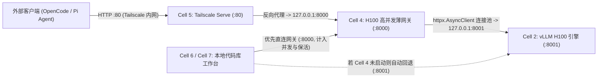

# Qwen3.8-27B H100 (80GB) vLLM 满血推理与代码库工作台 Pipeline

本项目专为 **Google Colab 单卡 NVIDIA H100 (80GB HBM3, Hopper `sm_90`)** 打造，将原 `qwen38_27b/` 的进程内 Transformers 串行推理全面升级为 **vLLM 满血推理后端 + 异步并发网关 + 本地高速代码库工作台**，全面释放 Hopper 架构的算力、显存带宽与高并发吞吐潜力。

---

## 1. 与原版 (`qwen38_27b/`) 核心架构对比

| 维度 | 原版 `qwen38_27b/` (Transformers + FLA) | 本版 `qwen38_27b_h100/` (H100 vLLM 满血版) |
| :--- | :--- | :--- |
| **推理引擎** | 进程内 `transformers` + `flash-linear-attention` + `causal-conv1d` | 独立子进程 **vLLM** (`--tensor-parallel-size 1`)，原生 Hopper 算子优化 |
| **并发与调度** | `G4FairStepScheduler` 单锁时间片轮转，API 与本地工作台互斥阻塞 | **Continuous Batching** 连续批处理 + FastAPI `httpx.AsyncClient` 连接池无锁透传，外部客户端与 Cell 6/7 真正并行 |
| **多轮探索加速** | 每次推理需重算或依赖单会话 KV，无法跨轮/跨请求共享前缀 | **Automatic Prefix Caching** + **Chunked Prefill**：多轮 `agent` 工具调用中系统提示词、目录树与前序工具结果自动命中显存前缀缓存，TTFT 断崖式下降 |
| **解码加速** | 单 Token 常规自回归解码 | **MTP 投机解码** (`--speculative-config '{"method": "mtp", "num_speculative_tokens": 3}'`)，大幅提升 Decode 阶段 tok/s |
| **KV Cache 精度** | 默认 BF16 KV Cache | 默认开启 **H100 FP8 KV Cache** (`--kv-cache-dtype fp8`)，同等显存可承载翻倍上下文与并发序列 |
| **工作台调用方式** | 依赖全局变量 `model` / `tokenizer`，进程内直接 `model.generate` | 彻底解耦！通过 `httpx` 本地回环 HTTP SSE (`/chat/completions`) 自动探测并优先经由 Cell 4 (`8000`) 或无缝回退直连 Cell 2 (`8001`) |
| **结构化解析** | 依赖正则剥离 `<think>` 与 `<tool_call>` | 双通道解析：优先消费 vLLM 原生 `delta.reasoning_content` / `delta.reasoning` 与增量 `delta.tool_calls`，同时保留 `<think>` / `<tool_call>` 文本兜底剥离 |
| **进程/显存隔离** | 网关、保活与模型共享主进程，易受 PyTorch 显存碎片影响 | vLLM 独立子进程管理 paged KV 显存；Cell 5 通过 `nvidia-smi` 与 `/v1/metrics` 实时监控真实显存与队列并发 |

---

## 2. 80GB H100 显存预算分配说明

在 Cell 2 顶部可通过 `MODEL_PRECISION` 一键切换精度模式；无论选择哪种精度，vLLM 均通过 `--served-model-name Qwen/Qwen3.8-27B` 统一暴露模型名称，**OpenCode / Pi Agent / Cell 6 无需改动任何客户端配置**。

### 模式一：原生无损 BF16（默认：`MODEL_PRECISION = "bf16"`）
* **HF 仓库**：`Qwen/Qwen3.8-27B`
* **显存分配（总计 80GB HBM3）**：
  * 模型权重（BF16）：约 **~54 GB**
  * 预留显存利用上限：`gpu_memory_utilization = 0.92`（约 **~73.6 GB** 纳入 vLLM 统一显存池）
  * **FP8 KV Cache (`KV_CACHE_DTYPE = "fp8"`)**：剩余 ~19.6 GB 在 FP8 量化下等效于 ~39 GB BF16 KV 空间，轻松支撑 **`max_model_len = 65536`**（65K 上下文）、`max_num_seqs = 8`、`max_num_batched_tokens = 16384`。
  * 若手动改为 `KV_CACHE_DTYPE = "auto"`（或非 `sm_90`/`sm_100+` 环境自动回退），上下文将自适应调整为 `32768` 以防 OOM。

### 模式二：超长上下文与高并发 FP8（`MODEL_PRECISION = "fp8"`）
* **HF 仓库**：`Qwen/Qwen3.8-27B-FP8`（`dtype = "auto"`）
* **显存分配（总计 80GB HBM3）**：
  * 模型权重（FP8）：约 **~30 GB**
  * **FP8 KV Cache + 充足空闲池**：释放约 **~50 GB** 显存给 PagedAttention KV Cache（`gpu_memory_utilization = 0.90`）
  * 默认支撑 **`max_model_len = 131072`**（实测单会话长思考与多路并发极宽裕，可按需上调至 **262,144**）、`max_num_seqs = 16`、`max_num_batched_tokens = 32768`。

### 多模态显存保护
* 默认配置 `MAX_MM_IMAGES_PER_PROMPT = 8`，即 `--limit-mm-per-prompt '{"image": 8, "video": 0}'`，完整保留看图编程/UI 截图分析能力，同时避免为未使用的视频模态预留多余显存缓冲区。

---

## 3. Cell 1 ~ Cell 7 执行顺序与端口拓扑

### 端口与服务拓扑图

### 执行顺序与各 Cell 职责

1. **Cell 1 (`cell1.py`) — H100 环境初始化与云盘缓存持久化**
   * 幂等挂载 Google Drive（失败自动降级 `/tmp/colab_wheels`），识别 GPU 架构（预期 H100 `sm_90`）与 Python 版本。
   * 绑定并持久化 `TRITON_CACHE_DIR`、`VLLM_CACHE_ROOT`、`TORCHINDUCTOR_CACHE_DIR` 到云盘（按 `sm_{arch}_{py_tag}` 隔离），启用 `HF_HUB_ENABLE_HF_TRANSFER=1`。
   * 安装 `vllm`、`transformers`、`accelerate`、`hf_transfer`、`qwen-vl-utils`、`openai`、`httpx`、`fastapi`、`uvicorn`、`sse-starlette`。
2. **Cell 2 (`cell2.py`) — 启动 vLLM 满血 H100 后台服务 (`127.0.0.1:8001`)**
   * 配置 `MODEL_PRECISION` (`"bf16"` / `"fp8"`)、`KV_CACHE_DTYPE` (`"fp8"`) 与 `ENABLE_MTP_SPECULATIVE` (`True`)。
   * 幂等清理旧端口残留进程并拉起 `vllm serve`（日志写入 `/tmp/vllm_server.log`），等待 `/health` 就绪并完成轻量 Warmup，导出 `VLLM_BASE_URL`、`SERVED_MODEL_NAME` 等契约变量。
3. **Cell 3 (`cell3.py`) — 快速流式连通性与吞吐测速（可选）**
   * 默认 `RUN_SANITY_TEST = False` 便于一键“全部运行”；手动开启或调用 `chat_qwen38(...)` 可实时查看 TTFT、思考/正文分离流式输出与 `tok/s`。
4. **Cell 4 (`cell4.py`) — 启动 OpenAI 兼容高并发薄代理网关 (`127.0.0.1:8000`)**
   * 无锁异步转发至 vLLM `8001`，兼容 OpenCode / Pi Agent 的 `developer` 角色、`image_url` 多模态、`reasoning_effort` 映射、`reasoning` -> `reasoning_content` 补齐、SSE `: keep-alive` 心跳与断连自动中止。
   * 暴露 `GATEWAY_BASE_URL`、`h100_gateway_tracker` 与 `LAST_API_REQUEST_TIME`。
5. **Cell 5 (`cell5.py`) — Tailscale 内网固定域名暴露与保活守护（若需远程接入）**
   * 若仅在 Colab 内使用 Cell 6/7 代码库工作台，**可跳过 Cell 5** 直接运行 Cell 6；若需给本地电脑上的 OpenCode / Pi Agent 提供 API，则运行 Cell 5 暴露 `http://colab-llm.<tailnet>/v1`。
   * 综合 `h100_gateway_tracker.active_sessions` 与 vLLM `/v1/metrics`（`running + waiting` 请求数）、`nvidia-smi` 真实显存占用进行监控；闲置超时（默认 120 分钟）前先优雅关闭 `VLLM_PROCESS` 与 `uvicorn_server` 再释放运行时。
6. **Cell 6 (`cell6.py`) — 本地高速代码库同步与工作台引擎注册**
   * 在顶部修改 `DRIVE_REPO_PATH`（支持普通目录或 `.zip` / `.tar.gz` 压缩包），将源码多线程增量过滤同步至 `/content/local_codebase/`（跳过 `.git`、`node_modules`、二进制和大文件）。
   * 若 `DRIVE_REPO_PATH` 保持默认占位路径且不存在，会友好提示而不会中断 `ask_qwen` 等核心函数注册。
7. **Cell 7 (`cell7.py`) — 交互式代码库深度分析入口**
   * 支持三种模式：
     * `MODE = "agent"`：挂载只读工具（`list_dir` / `find_files` / `grep_search` / `read_file`），配合 vLLM Prefix Caching 自主多轮精读源码。
     * `MODE = "pack"`：按 `FILES` 通配符与目录树一次性打包源码投喂。
     * `MODE = "chat"`：结合 `KEEP_HISTORY = True` 或 `CONTEXT_MDS` 进行多轮方案追问。
   * 所有输出均自动剥离思考过程与工具标签，保存为纯净 `.md` 文件并容错同步至 Google Drive。

---

## 4. 常见问题排查

### Q1: 如何安全配置 `HF_TOKEN` 与 `TS_AUTHKEY`？
* 请在 Google Colab 左侧边栏 **🔑 Secrets (密钥)** 中添加 `HF_TOKEN`（用于下载 Hugging Face 模型权重，或访问受限仓库）和 `TS_AUTHKEY`（用于 Tailscale 节点认证），并确保勾选“Notebook access”。
* **严禁将任何 Token/AuthKey 明文硬编码到代码单元格或提交至仓库**；代码亦支持通过系统环境变量 `HF_TOKEN` / `TS_AUTHKEY` 注入。

### Q2: 开启 MTP 投机解码或超长上下文遇到异常怎么办？
* **Cell 2 三级自动回退梯队**：当 `ENABLE_MTP_SPECULATIVE = True` 启动 `vllm serve` 失败时，Cell 2 会自动打印 `/tmp/vllm_server.log` 的尾部日志并按梯队依次回退重试：先尝试**关闭 MTP (`--speculative-config`)**、若仍失败且开启了 `fp8` KV Cache 则进一步回退到 **`kv_cache_dtype="auto"`**，最大限度保障服务稳定拉起。
* **Cell 4 长上下文 HTTP 400 自动截断重试**：当请求输入长度与 `max_tokens` 之和超出模型 `max_model_len` 导致 vLLM 返回 HTTP 400 时，Cell 4 网关会自动解析剩余可用上下文窗口并安全截断 `max_tokens` 后透明重试一次（流式与非流式均生效）。

### Q3: 云盘缓存与输出文件保存在哪里？
* **算子与模型编译缓存**：`<Drive>/MyDrive/colab_wheels/`（包含 `triton_cache_sm_{arch}_{py_tag}`、`vllm_cache_sm_{arch}_{py_tag}`、`torchinductor_cache_sm_{arch}_{py_tag}`）。若未挂载 Google Drive，自动降级到 `/tmp/colab_wheels/`。
* **Tailscale 固定节点身份**：`<Drive>/MyDrive/colab_wheels/tailscale_node_colab-llm/tailscaled.state`。重启 Colab 后会自动恢复，避免 Tailscale 后台不断产生 `-1`、`-2` 重复设备。
* **工作台本地源码缓存**：`/content/local_codebase/<项目名>/`（位于 Colab 本地高速 NVMe 盘，消除 Google Drive FUSE 小文件读取卡顿）。
* **生成的 Markdown 分析报告**：优先写入 Colab 本地 `/content/local_outputs/<项目名>/`，并实时同步至 `<Drive>/MyDrive/qwen_code_reports/<项目名>/`。若未挂载 Google Drive，工作台会自动跳过云盘复制并安全保留本地 `.md` 文件，不会中断流程。

### Q4: Cell 6/7 提示未检测到本地推理服务怎么办？
* 请确认 **Cell 2** 已成功运行并通过 `/health` 自检（端口 `8001`）。
* 若希望同时计入网关并发统计并兼容外部客户端并发，建议也运行 **Cell 4**（端口 `8000`）。Cell 6 会自动优先探测 `8000`，若未开启则无缝回退 `8001`；也可在 Cell 6 顶部通过 `LOCAL_API_BASE_URL` 手动指定端点。
